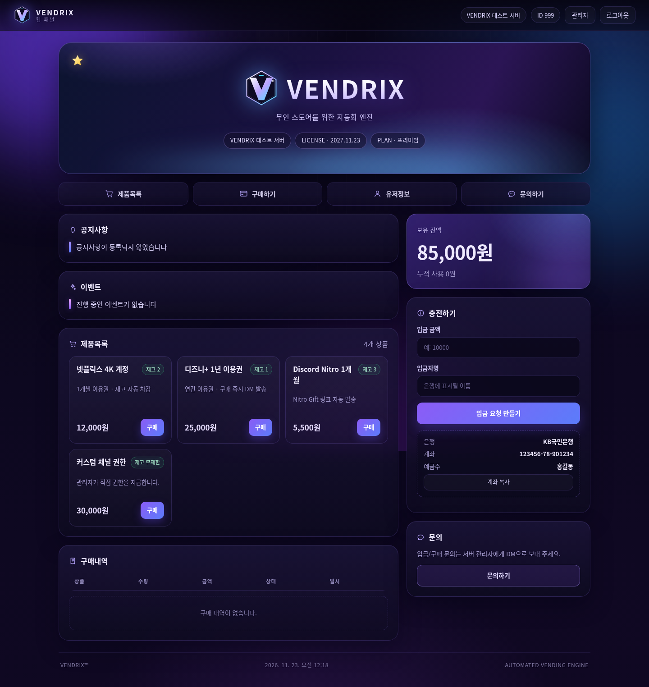
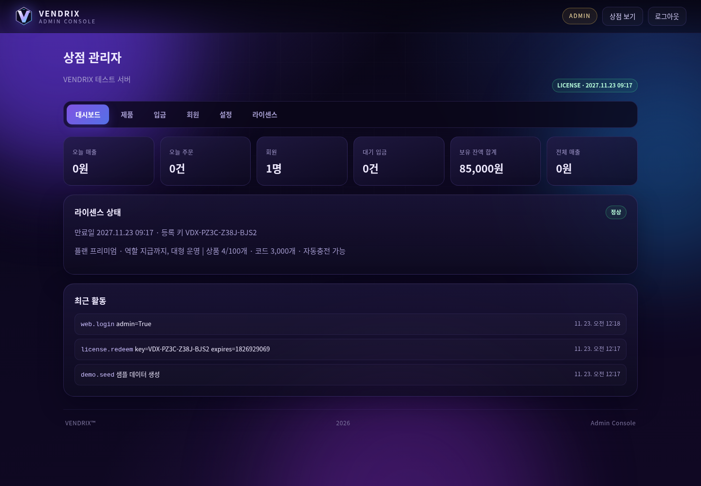
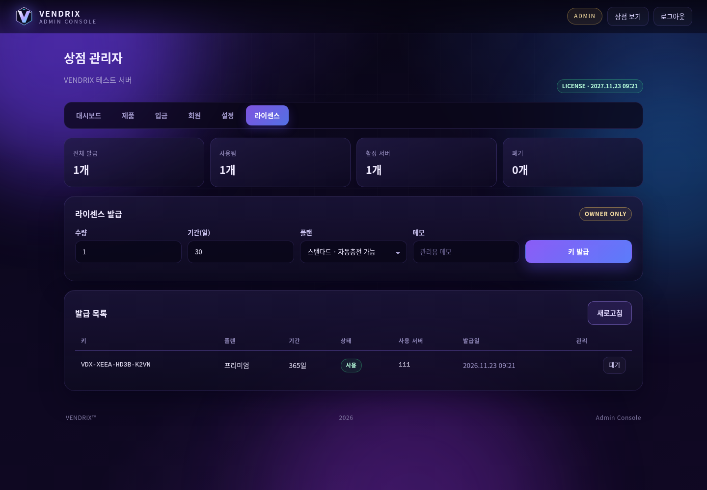
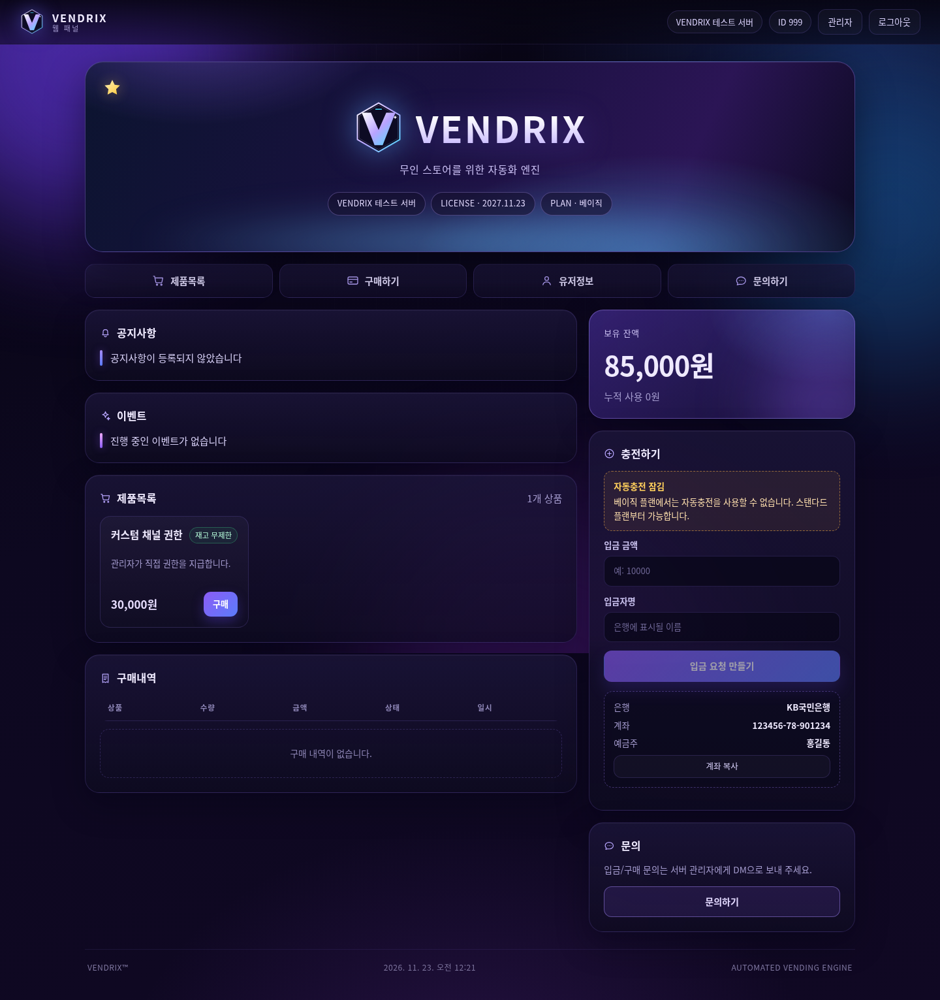
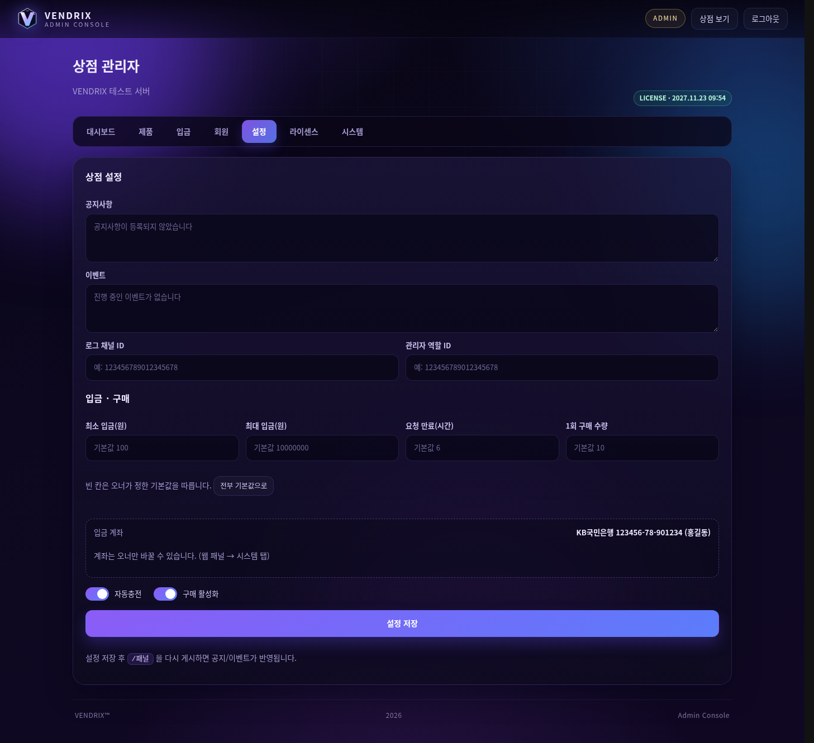
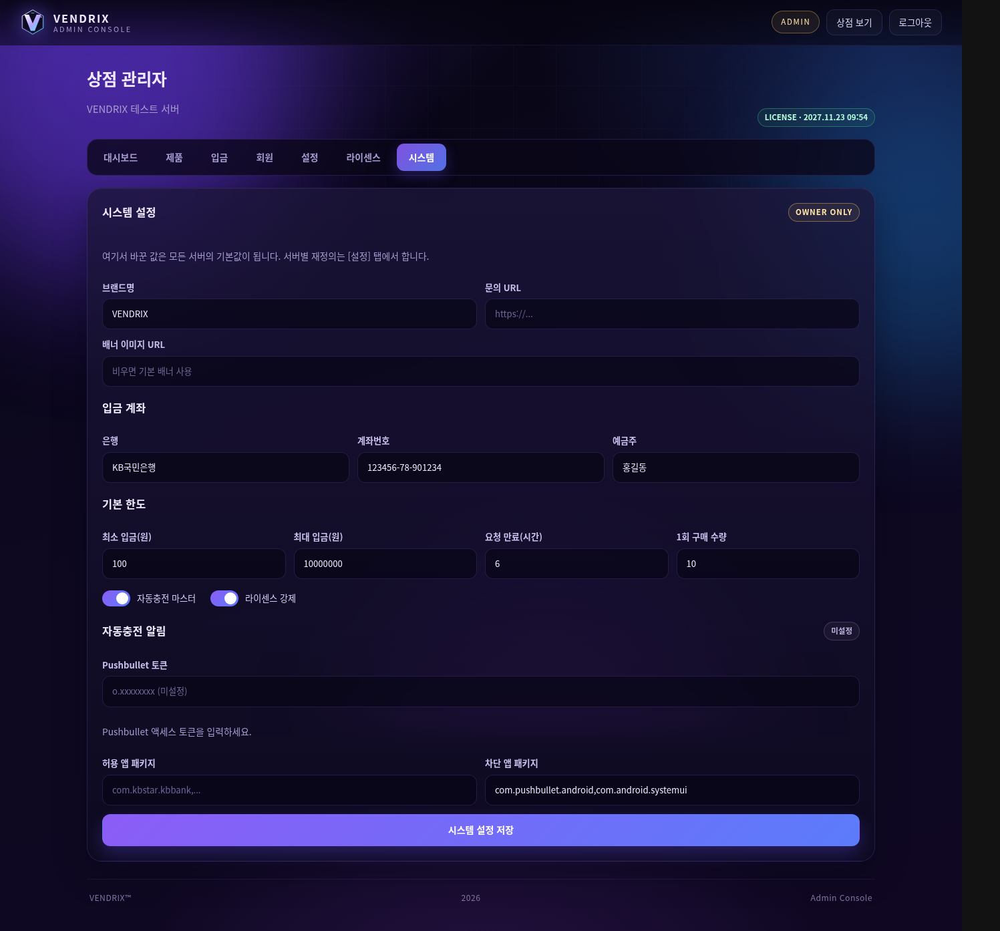

# VENDRIX

> **VEND**ING + **X** — 무인 스토어를 위한 자동화 엔진

디스코드 봇 + 웹 패널로 운영하는 무인 스토어 플랫폼입니다.
슬래시 명령어로 상품을 판매하고, **Pushbullet 알림 미러링**으로 은행 입금을 자동 확인해 잔액을 충전합니다.
라이센스 키는 **오너만** 발급할 수 있으며, 봇과 웹 양쪽에서 관리할 수 있습니다.



| 관리자 콘솔 | 오너 라이센스 콘솔 |
| --- | --- |
|  |  |

모바일 화면은 [docs/panel-mobile.png](docs/panel-mobile.png) 에서 확인할 수 있습니다.

---

## 1. 주요 기능

- **디스코드 패널** — `/패널` 한 번으로 배너·공지·이벤트·빠른 메뉴가 담긴 상점 게시
- **상품 판매** — 잔액 결제, 재고 자동 차감, 역할 지급 / 상품 코드 DM / 수동 전달
- **자동 충전** — 안드로이드 은행 앱 알림을 Pushbullet으로 미러링 → 입금자명·금액·메모 코드 매칭 → 잔액 자동 반영
- **웹 패널** — `/웹패널` 1회용 링크 로그인, 구매·충전·내역 확인, 관리자 콘솔(상품/입금/회원/설정)
- **라이센스** — `VDX-XXXX-XXXX-XXXX` 키 발급/폐기/현황, 서버당 1회 등록, 만료 시 판매·자동충전 차단
- **플랜(등급)** — 베이직/스탠다드/프리미엄/플래티넘. 상품 수·코드 수·전달 방식·자동충전·웹 패널이 등급별로 제한
- **감사 로그** — 구매·충전·라이센스·관리자 조작 기록

---

## 2. 빠른 시작

### 요구 사항

- Python **3.11 이상** (3.12/3.13/3.14 확인)
- 디스코드 봇 토큰, 봇을 초대할 서버
- (자동충전) 안드로이드 폰 + Pushbullet 계정 + 은행 앱 알림

### Linux / macOS

```bash
cd vendrix
python3 -m venv .venv
source .venv/bin/activate
pip install -r requirements.txt

cp .env.example .env
nano .env                      # 아래 3개는 필수
python main.py --check          # 설정 점검
python main.py
```

`start.sh` 를 사용하면 위 과정(가상환경 생성·의존성 설치·`.env` 복사)을 자동으로 처리합니다.

```bash
chmod +x start.sh
./start.sh
```

### Windows

```bat
cd vendrix
start.bat
```

`start.bat` 은 `.venv` 생성 → 의존성 설치 → `.env` 복사 → `python main.py` 순으로 실행합니다.
수동으로 하려면:

```bat
python -m venv .venv
.venv\Scripts\activate
pip install -r requirements.txt
copy .env.example .env
notepad .env
python main.py
```

### 필수 환경 변수

| 변수 | 설명 |
| --- | --- |
| `DISCORD_TOKEN` | 디스코드 봇 토큰 |
| `OWNER_IDS` | 오너 디스코드 유저 ID (콤마 구분). 라이센스 발급/폐기 권한 |
| `PUBLIC_BASE_URL` | 배너 이미지·웹 로그인 링크에 쓰이는 외부 주소 (예: `https://panel.example.com`) |

`DB_PATH`·`WEB_HOST`·`WEB_PORT`·`COOKIE_SECURE` 같은 실행 환경 값만 `.env` 에 두면 됩니다.
`python main.py --check` 로 누락 여부를 확인할 수 있습니다.

### 자판기 설정은 `.env` 가 아니라 패널/명령어에서

브랜드명·배너·입금 계좌·입금 한도·구매 수량·자동충전 마스터·Pushbullet 토큰·알림 앱 패키지 같은
**운영 설정은 SQLite `settings` 테이블**에 저장됩니다. 우선순위는 아래와 같습니다.

1. 서버별 값 (`/설정` 또는 관리자 → **설정** 탭) — 해당 서버에만 적용
2. 전역 값 (오너 → **시스템** 탭) — 모든 서버 기본값
3. `.env` 값 — 최초 부팅 시 전역 기본값을 채우는 용도로만 사용

즉 `.env` 는 부트스트랩이고, 이후 값은 웹 패널이나 `/설정` 으로 바꾸면 **재시작 없이 즉시** 반영됩니다.
Pushbullet 토큰을 바꾸면 리스너가 자동으로 재접속합니다.

```bash
python main.py                  # 봇 + 웹 + 자동충전
python main.py --web-only       # 웹 패널만 (봇 토큰 없이 UI 확인)
python main.py --host 0.0.0.0 --port 8080
python main.py --check          # 설정/의존성 점검만
```

---

## 3. 디스코드 봇 준비

1. [Discord Developer Portal](https://discord.com/developers/applications) → **New Application**
2. **Bot** 탭 → **Reset Token** → 토큰을 `.env` 의 `DISCORD_TOKEN` 에 입력
3. 내 디스코드 ID 확인: 디스코드 설정 → 고급 → **개발자 모드** ON → 내 프로필 우클릭 → **ID 복사** → `.env` 의 `OWNER_IDS` 에 입력
4. **Installation** 탭에서 초대 링크 생성
   - Scopes: `bot`, `applications.commands`
   - Bot Permissions: `Send Messages`, `Embed Links`, `Attach Files`, `Read Message History`, `Manage Roles`, `Use External Emojis`
5. 봇을 서버에 초대하고, 봇 역할을 지급할 역할보다 **위**에 배치
6. **Bot → Icon** 에 `app/static/avatar.png` (512×512, 원형 크롭 안전) 를 업로드하면 봇 프로필이 VENDRIX 엠블럼으로 표시됩니다.
7. 개발 중에는 `.env` 의 `GUILD_ID` 에 서버 ID를 넣으면 슬래시 명령어가 즉시 동기화됩니다. 비우면 전역 동기화(최대 1시간 소요)입니다.

> 배너 이미지는 `PUBLIC_BASE_URL/static/banner.png` 로 제공됩니다. 디스코드가 이미지를 불러올 수 있도록 **외부에서 접근 가능한 HTTPS 주소**여야 합니다. 별도 이미지를 쓰려면 `BANNER_URL` 을 지정하세요.

---

## 4. 플랜(등급)과 기능 제한

라이센스 키를 발급할 때 **플랜**을 선택하면, 그 서버에서 쓸 수 있는 봇/웹 기능이 제한됩니다.
**자동충전은 중간 등급인 `스탠다드`부터** 열립니다.

| 플랜 | 자동충전 | 상품 | 상품 코드 | 전달 방식 | 웹 패널 |
| --- | --- | --- | --- | --- | --- |
| **베이직** | ✕ | 10개 | 100개 | 수동 전달 | ✕ |
| **스탠다드** | **✓** | 30개 | 500개 | 수동 · 코드 | ✓ |
| **프리미엄** | ✓ | 100개 | 3,000개 | 수동 · 코드 · 역할 | ✓ |
| **플래티넘** | ✓ | 무제한 | 무제한 | 전체 | ✓ |

- 플랜은 **라이센스 키에 귀속**됩니다. 서버의 플랜은 `/등록` 한 키(또는 오너 등록)로 결정됩니다.
- 상위 플랜 키를 다시 등록하면 만료일이 연장되고 플랜도 함께 올라갑니다.
- 오너가 `/등록` 을 키 없이 실행한 서버는 **플래티넘**으로 동작합니다.
- `LICENSE_ENFORCE=true` 이면 라이센스가 없거나 만료된 서버는 판매·자동충전이 모두 차단됩니다.
- 플랜에서 허용하지 않는 전달 방식은 상품 생성·구매 단계에서 모두 거부됩니다.
- 한도에 도달하면 웹 관리자 콘솔과 봇이 업그레이드 안내를 표시합니다.

베이직 플랜에서 자동충전이 잠긴 화면:



## 5. Pushbullet 자동 충전 설정 (안드로이드)

자동 충전은 **폰에 도착한 은행 입금 알림**을 Pushbullet이 서버로 미러링하면 동작합니다.
봇이 은행 API에 직접 접속하는 방식이 아니므로, 입금 알림이 오는 폰에서 아래를 한 번만 설정하면 됩니다.

### 4-1. 폰 설정

1. Play 스토어에서 **Pushbullet** 설치 후 서버와 **같은 Google 계정**으로 로그인
2. Pushbullet 앱 → **Settings → Notification Mirroring** 활성화
3. 안드로이드 설정 → **알림 접근 권한(Notification access)** 에서 Pushbullet 허용
4. 배터리 최적화 예외에 Pushbullet 추가 (삼성: 설정 → 배터리 → 백그라운드 사용 제한 → 예외)
5. 은행 앱의 **입금 알림**이 실제로 뜨는지 확인 (은행 앱 알림 설정에서 입금 알림 허용)
6. Pushbullet 웹 → [Settings → Account](https://www.pushbullet.com/#settings/account) → **Create Access Token** → 웹 패널 **시스템** 탭의 *Pushbullet 토큰* 에 입력 후 저장 (저장 즉시 재접속)

### 4-2. 서버 설정

오너 계정으로 웹 패널 → **시스템** 탭에서 아래 값을 입력하고 **시스템 설정 저장** 을 누르세요.
토큰을 저장하면 리스너가 자동으로 재연결되며, 봇을 재시작할 필요가 없습니다.

| 항목 | 설명 |
| --- | --- |
| Pushbullet 토큰 | `o.` 로 시작하는 Access Token |
| 허용 앱 패키지 | 비우면 입금 키워드로만 판별. 특정 은행만 쓰려면 `com.kbstar.kbbank,com.shinhan.sbanking` |
| 차단 앱 패키지 | 기본 `com.pushbullet.android,com.android.systemui` |
| 자동충전 마스터 | 전체 서버 자동충전 ON/OFF |

`.env` 의 `PUSHBULLET_TOKEN`·`PUSHBULLET_ALLOWED_PACKAGES`·`PUSHBULLET_BLOCKED_PACKAGES`·`AUTO_CHARGE_ENABLED` 는
**최초 부팅 시 전역 기본값**을 채우는 용도입니다. 이후에는 패널/`/설정` 값이 우선합니다.

```env
# .env 는 부트스트랩만 (선택)
PUSHBULLET_TOKEN=o.xxxxxxxxxxxxxxxxxxxxxxxx
PUSHBULLET_BLOCKED_PACKAGES=com.pushbullet.android,com.android.systemui
```

- 웹소켓(`wss://stream.pushbullet.com`)으로 실시간 수신하고, 끊김/누락에 대비해 `PUSHBULLET_POLL_SECONDS` 주기로 REST 폴링을 병행합니다.
- `PUSHBULLET_ALLOWED_PACKAGES` 가 비어 있으면 **입금 키워드로만** 판별합니다. 광고성 알림이 많다면 은행 앱 패키지를 지정하는 것을 권장합니다.
- SMS로 오는 입금 알림(`sms_changed`)도 동일하게 처리합니다.

### 4-3. 입금 → 자동 충전 흐름

1. 사용자가 디스코드 `/입금 금액:10000 입금자명:홍길동` 또는 웹 패널 **충전하기** 로 요청 생성
2. 안내된 계좌로 **정확한 금액**을 입금 (입금자명 일치, 메모에 5자리 코드를 넣으면 더 정확)
3. 폰에 은행 입금 알림 도착 → Pushbullet이 서버로 전달
4. 서버가 대기 중인 입금 요청과 매칭 → 잔액 자동 증가, 디스코드/웹에 알림
5. 매칭 결과가 애매하면 `review` 로 저장되어 관리자가 `/관리` 또는 웹 **입금** 탭에서 승인/무시

### 4-4. 매칭 점수

| 조건 | 점수 |
| --- | --- |
| 메모 코드 일치 | 300 |
| 예금주 이름 일치 | 100 |
| 금액만 일치 (이름/코드 없음) | 5 |
| 이름 불일치 | 0 |

- 최고 점수가 동점이면 `review`, 60점 미만이면 `review`, 후보가 없으면 `unmatched`
- `review`/`unmatched` 는 자동 충전되지 않습니다. 관리자 승인 시 잔액이 반영됩니다.
- 같은 알림(`iden`)이 중복 수신되면 `duplicate` 로 무시됩니다.

> **보안 안내**: Pushbullet 토큰은 계정의 모든 알림 열람 권한을 가집니다. `.env` 를 커밋하거나 공유하지 마세요. 토큰이 유출되면 Pushbullet에서 즉시 재발급하세요.

---

## 6. 명령어

| 명령어 | 설명 | 권한 |
| --- | --- | --- |
| `/패널` | 상점 패널을 현재 채널에 게시 | 서버 관리자 |
| `/관리` | 관리자 콘솔(상품/입금/회원/설정) | 서버 관리자 |
| `/등록 라이센스:<키>` | 서버에 라이센스 등록 (오너는 키 생략 가능) | 서버 관리자 |
| `/웹패널` | 웹 패널 1회용 로그인 링크 발급 (15분) | 전체 |
| `/제품전송 상품 대상 수량` | 회원에게 상품 지급 | 서버 관리자 |
| `/충전 대상 금액` | 잔액 충전 (음수면 차감) | 서버 관리자 |
| `/잔액` | 내 잔액·입금 요청 확인 | 전체 |
| `/입금 금액 입금자명` | 입금 요청 생성 + 계좌 안내 | 전체 |
| `/구매 상품 수량` | 잔액으로 상품 구매 | 전체 |
| `/공지 공지 이벤트` | 패널 공지/이벤트 문구 수정 | 서버 관리자 |
| `/플랜` | 현재 서버 플랜과 등급별 기능 제한 확인 | 전체 |
| `/설정 보기` | 현재 서버에 적용 중인 설정과 출처(서버/전역) 확인 | 서버 관리자 |
| `/설정 계좌 은행 계좌번호 예금주` | 입금 계좌 변경 | 서버 관리자 |
| `/설정 입금 최소 최대 만료시간` | 입금 한도·요청 만료 시간 변경 | 서버 관리자 |
| `/설정 구매수량 수량` | 1회 구매 수량 제한 변경 | 서버 관리자 |
| `/설정 자동충전 켜기/끄기` | 서버 자동충전 스위치 | 서버 관리자 |
| `/설정 구매 켜기/끄기` | 서버 구매 스위치 | 서버 관리자 |
| `/설정 웹` | 웹 패널 1회용 로그인 링크 발급 | 서버 관리자 |
| `/설정 초기화 항목` | 서버 값을 지우고 전역 기본값으로 되돌림 | 서버 관리자 |
| `/라이센스 발급 수량 기간 플랜 메모` | 라이센스 키 발급 (플랜: basic/standard/premium/platinum) | **오너 전용** |
| `/라이센스 목록` | 최근 발급 키 확인 | **오너 전용** |
| `/라이센스 폐기 키` | 키 폐기 | **오너 전용** |
| `/라이센스 정보` | 전체 발급/사용/폐기/활성 서버 현황 | **오너 전용** |

- 라이센스 키 형식: `VDX-XXXX-XXXX-XXXX`
- 키는 **서버당 1회** 등록할 수 있고, 이미 등록된 서버에서 새 키를 등록하면 **만료일이 연장**됩니다.
- 오너가 `/등록` 을 키 없이 실행하면 해당 서버에 10년 라이센스가 등록됩니다(테스트/본인 서버용).
- `LICENSE_ENFORCE=true` 이면 라이센스가 없거나 만료된 서버에서 상품 등록·구매·자동충전이 차단됩니다.

---

## 7. 웹 패널

- 디스코드에서 `/웹패널` → 15분간 유효한 1회용 링크 → 로그인 쿠키 7일
- 사용자: 잔액, 상품 구매, 입금 요청, 구매 내역, 문의
- 관리자: 대시보드, 상품/재고 CRUD, 입금 승인·무시, 회원 충전, 재전송, 공지/이벤트
- **설정 탭**: 서버별 계좌·한도·자동충전/구매 스위치 (전역 값과 다르면 `서버 설정` 배지 표시)
- 오너 **시스템 탭**: 브랜드명·배너·전역 계좌·기본 한도·자동충전 마스터·라이센스 강제·Pushbullet 토큰/앱 패키지
- 오너 **라이센스 탭**: 키 발급/폐기/현황 확인 (봇 명령어와 동일 권한)






운영 시 **HTTPS** 를 사용하고 `COOKIE_SECURE=true`, `PUBLIC_BASE_URL=https://...` 로 설정하세요.
웹은 `HttpOnly` 쿠키 + CSRF 헤더(`X-VDX-CSRF`) + Origin 검증 + CSP + 요청 속도 제한으로 보호됩니다.

---

## 8. 운영 배포

### systemd (Linux)

```ini
# /etc/systemd/system/vendrix.service
[Unit]
Description=VENDRIX
After=network-online.target

[Service]
Type=simple
User=vendrix
WorkingDirectory=/opt/vendrix
EnvironmentFile=/opt/vendrix/.env
ExecStart=/opt/vendrix/.venv/bin/python main.py
Restart=always
RestartSec=5

[Install]
WantedBy=multi-user.target
```

```bash
sudo systemctl daemon-reload
sudo systemctl enable --now vendrix
sudo journalctl -u vendrix -f
```

### Docker

```bash
cp .env.example .env
nano .env
docker compose up -d --build
docker compose logs -f
```

`docker-compose.yml` 은 `./data` 를 컨테이너 `/app/data` 에 마운트해 SQLite DB를 보존합니다.
리버스 프록시(Nginx/Caddy) 뒤에 두고 HTTPS를 적용하세요.

### 백업

모든 데이터는 `data/vendrix.db` (SQLite WAL)에 있습니다. 서비스 중지 후 `vendrix.db`, `vendrix.db-wal`, `vendrix.db-shm` 을 함께 복사하거나 `sqlite3 data/vendrix.db ".backup backup.db"` 를 사용하세요.

---

## 9. 테스트

```bash
pip install -r requirements-dev.txt
python -m pytest -q tests/
```

- `test_deposits.py` — 한국 은행 알림 12종 파싱/오탐 검증
- `test_flow.py` — 구매·충전·선물·자동충전·중복·라이센스 차단
- `test_pushbullet.py` — 미러링 알림 수신 → 자동 충전, 중복/일반 알림 무시, SMS 경로
- `test_commands.py` — 슬래시 명령어 등록/직렬화
- `test_web.py` — 웹 로그인·구매·입금 API, 설정 저장/서버 오버라이드
- `test_plans.py` — 플랜별 상품·코드·자동충전 제한
- `test_settings.py` — 전역/서버 설정 우선순위·초기화·토큰 마스킹

디자인만 빠르게 확인하려면 샘플 데이터로 웹 패널만 실행할 수 있습니다.

```bash
python tools/demo_panel.py --port 8099
# 출력되는 관리자 로그인 URL 로 접속
```

---

## 10. 프로젝트 구조

```
vendrix/
├── main.py                # 단일 실행 파일 (봇 + 웹 + Pushbullet)
├── app/
│   ├── config.py          # .env(실행 환경) 설정
│   ├── settings_store.py  # DB 기반 운영 설정(전역/서버) + 마스킹
│   ├── plans.py           # 플랜 등급·기능 제한
│   ├── db.py              # SQLite (WAL, 트랜잭션)
│   ├── schema.sql
│   ├── deposits.py        # 입금 파서 + 자동 매칭
│   ├── pushbullet.py      # 웹소켓/폴링 리스너
│   ├── service.py         # 구매·충전·라이센스 공용 로직
│   ├── bot.py             # 슬래시 명령어·패널·모달
│   ├── web.py             # aiohttp 웹 패널/API
│   ├── templates/         # Jinja2 (landing/panel/admin/error)
│   └── static/            # CSS/JS/로고/배너
├── tests/
├── tools/
│   ├── demo_panel.py      # 샘플 데이터 데모
│   └── make_assets.py     # 로고/배너 생성
└── docs/                  # 스크린샷
```

---

## 11. 문제 해결

| 증상 | 확인 |
| --- | --- |
| 디스코드 패널에 배너가 안 보임 | `PUBLIC_BASE_URL` 이 외부에서 접근 가능한 주소인지, `/static/banner.png` 가 열리는지 확인 |
| 슬래시 명령어가 안 보임 | `GUILD_ID` 설정 후 재시작, 봇 재초대(`applications.commands`), Discord 재로그인 |
| 상품 코드 DM이 안 옴 | 구매자가 DM 허용, 봇과 서버에 `Send Messages` 권한, 실패 시 관리자 로그 채널로 코드 전송 |
| 자동 충전이 안 됨 | ① 폰 알림 미러링/알림 접근 권한 ② 오너 **시스템** 탭의 Pushbullet 토큰 ③ 서버 `auto_charge` ON ④ 라이센스 유효 ⑤ 입금자명/금액 일치 |
| `review` 로만 쌓임 | 동일 금액 요청이 여러 건이거나 이름이 다름 → 웹 **입금** 탭에서 승인 |
| 웹 로그인 링크 만료 | `/웹패널` 다시 실행 (링크는 1회용·15분) |
| `database is locked` | 앱은 단일 프로세스로 실행하세요. 여러 인스턴스를 띄우지 마세요. |

---

## 12. 보안 체크리스트

- [ ] `.env` 를 저장소에 커밋하지 않기 (`.gitignore` 포함)
- [ ] 봇 토큰/Pushbullet 토큰 주기적 교체
- [ ] 웹 패널 HTTPS + `COOKIE_SECURE=true`
- [ ] `OWNER_IDS` 를 실제 오너 계정으로만 제한
- [ ] 관리자 역할은 최소 인원에게 부여
- [ ] 정기 백업 (`data/vendrix.db`)

---

`VENDRIX™` · Powered by Discord
